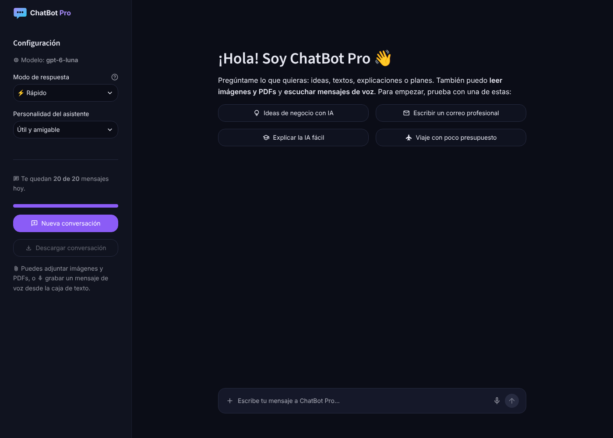

## 🤖 Chatbot con Streamlit + LangChain

Un chatbot hecho con **Streamlit**, **LangChain** y **OpenAI** que conversa en tiempo real, **lee imágenes y PDFs**, **entiende mensajes de voz** y **lee sus respuestas en voz alta**. Tiene personalidades configurables y un **límite de mensajes por usuario** para controlar el gasto de la API.

### 👉 [Probar el chatbot en vivo](https://stream-lit-chatbot-nxppwxmprtwxy9gdn6wvvg.streamlit.app/)

[](https://stream-lit-chatbot-nxppwxmprtwxy9gdn6wvvg.streamlit.app/)



---

## 🚀 Funcionalidades

- 🎨 **Interfaz propia**: tema oscuro con morado, tipografía Inter, logo y avatares (se configura en `.streamlit/config.toml`)
- 👋 **Pantalla de bienvenida** con preguntas sugeridas para empezar con un clic
- 👍 **Botones en cada respuesta**: valorar (👍/👎, se registra en los logs), copiar y regenerar la última respuesta
- 💾 **Descargar la conversación** como archivo Markdown
- 🖼️ **Imágenes y PDFs**: adjunta hasta 3 archivos por mensaje desde la caja de texto (imágenes PNG/JPG/WEBP/GIF y PDFs con texto, máx. 10 MB c/u)
- 🎤 **Mensajes de voz**: graba desde el micrófono de la caja de texto; se transcriben con `gpt-transcribe`
- 🔊 **Escuchar respuestas**: botón que lee la respuesta en voz alta con la voz del navegador (gratis, no gasta saldo de OpenAI)
- ⚡ **Modo de respuesta**: Rápido, Equilibrado o Profundo (cuánto "piensa" el modelo antes de responder)
- 🔥 **Respuestas en streaming** (se escriben en tiempo real), con indicador de "Pensando…"
- 🎛️ **Barra lateral de configuración**: modelo, modo de respuesta y personalidad del asistente (la temperatura aparece solo con modelos que la admiten)
- 🧠 **Historial real de la conversación**: el modelo recibe los últimos 10 mensajes
- 🛡️ **Límite de mensajes por usuario y por día** + tope global diario (protege tu saldo de OpenAI)
- ✂️ Largo máximo de preguntas y respuestas para controlar costos
- 🔄 Botón de **nueva conversación**
- ⚠️ Manejo de errores: si OpenAI falla, el mensaje no se descuenta del límite

---

## 💻 Ejecutarlo en tu computador

Necesitas Python 3.10 o superior y una API Key de OpenAI.

```bash
pip install -r requirements.txt
```

Crea el archivo `.streamlit/secrets.toml` copiando `.streamlit/secrets.toml.example` y pon tu clave:

```toml
OPENAI_API_KEY = "sk-..."
```

Luego ejecuta:

```bash
streamlit run streamlit_chatbot.py
```

Se abre en `http://localhost:8501`. La primera vez que grabes un mensaje de voz, el navegador te pedirá permiso para usar el micrófono (funciona en `localhost` y en cualquier dirección `https`).

> ⚠️ El archivo `secrets.toml` está en `.gitignore`: **nunca** subas tu API Key a GitHub.

---

## ☁️ Desplegarlo gratis en Streamlit Community Cloud

1. Entra a [share.streamlit.io](https://share.streamlit.io) con tu cuenta de GitHub.
2. **Create app** → elige este repositorio, la rama `main` y el archivo `streamlit_chatbot.py`.
3. En **Advanced settings → Secrets** pega el contenido de `.streamlit/secrets.toml.example` con tu clave real.
4. **Deploy**. Obtendrás un enlace del tipo `https://tu-chatbot.streamlit.app`.

---

## ⚙️ Configuración (en Secrets)

| Variable | Qué hace | Por defecto |
|---|---|---|
| `OPENAI_API_KEY` | Tu clave de OpenAI | — |
| `MAX_MENSAJES_POR_USUARIO` | Mensajes que cada usuario puede enviar por día | `20` |
| `MAX_MENSAJES_GLOBALES_DIA` | Tope diario sumando a todos los usuarios | `300` |
| `MAX_TOKENS_RESPUESTA` | Largo máximo de cada respuesta | `1000` |
| `MODELOS` | Modelos que aparecen en el selector (opcional) | `["gpt-6-luna"]` |
| `MODELO_TRANSCRIPCION` | Modelo para transcribir mensajes de voz (opcional) | `gpt-transcribe` |

**Modelo por defecto:** `gpt-6-luna`, el modelo más económico de OpenAI, que también entiende imágenes. Reemplaza a `gpt-4o-mini`, `gpt-4.1-mini` y `gpt-5-mini`, que OpenAI retira de su API entre diciembre de 2026 y enero de 2027.

**Cómo funciona el límite:** cada usuario se identifica por su dirección IP (o por su sesión si no hay IP disponible). Los contadores se reinician cada día a la medianoche (hora de Colombia) y también cuando la app se reinicia. El tope global es la red de seguridad: aunque alguien cambie de red para saltarse el límite individual, el gasto diario total nunca pasa de ese número de mensajes.

---

## 🎨 Personalizar

- **Nombre del bot:** variable `NOMBRE_BOT` en `streamlit_chatbot.py` (y el texto del logo en `assets/logo.svg`).
- **Colores y tipografía:** sección `[theme]` de `.streamlit/config.toml`.
- **Personalidades y preguntas sugeridas:** diccionarios `PERSONALIDADES` y `SUGERENCIAS` en `streamlit_chatbot.py`.

---

## 📁 Estructura del proyecto

```
streamlit_chatbot.py        # La app: interfaz, chat y conexión con OpenAI
adjuntos.py                 # Imágenes, PDFs, transcripción de voz y botón "Escuchar"
limite_mensajes.py          # Límite de mensajes por usuario y tope global diario
requirements.txt            # Librerías con versiones fijas
assets/                     # Logo e ícono
docs/captura.png            # Captura usada en este README
.streamlit/config.toml      # Tema (colores, tipografía) y opciones de la app
.streamlit/secrets.toml.example  # Plantilla de configuración (copiar a secrets.toml)
app/                        # Versión "Pro" en desarrollo (no se usa en el despliegue)
```

---

## 🏗️ Tecnologías

- Python 3.10+
- Streamlit
- LangChain (LCEL, `ChatPromptTemplate`, `MessagesPlaceholder`)
- OpenAI API (GPT-6 Luna para el chat, gpt-transcribe para la voz)
- pypdf y Pillow (lectura de PDFs e imágenes)
- Web Speech API del navegador (lectura en voz alta)

---

## 🧪 En desarrollo

La carpeta `app/` contiene una versión "Pro" en construcción con memoria a largo plazo y búsqueda en PDFs (RAG). Todavía no está terminada y no se usa en el despliegue.
